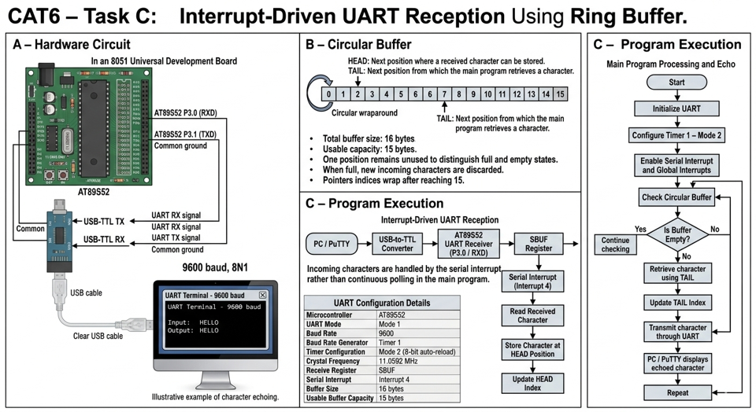

# CAT6 – Task C: Interrupt-Driven UART Reception Using Ring Buffer

## Experiment Details

| Field | Description |
| :--- | :--- |
| **Experiment ID** | CAT6 |
| **Date** | 20/08/2026 |
| **Experiment Name** | Interrupt-Driven UART Reception Using Ring Buffer |
| **Task Number** | Task C |
| **Microcontroller** | AT89S52 |
| **Development Board** | 8051 Universal Development Board |
| **Programming Language** | Embedded C |

## Objective

To implement interrupt-driven UART communication using the AT89S52 microcontroller. Incoming serial characters are received through the serial interrupt and temporarily stored in a 16-byte circular buffer. The main program retrieves the buffered characters and transmits them back to the PC terminal.

## Hardware Requirements

| Component | Specification |
| :--- | :--- |
| Microcontroller | AT89S52 |
| Development Board | 8051 Universal Development Board |
| Operating Voltage | +5V |
| Crystal Frequency | 11.0592 MHz |
| Communication Interface | UART |
| UART RX Pin | P3.0 (RXD) |
| UART TX Pin | P3.1 (TXD) |
| Serial Converter | USB-to-TTL Converter |
| PC Serial Terminal | PuTTY |
| Baud Rate | 9600 |
| Ring Buffer Size | 16 bytes |
| Programming Environment | Keil µVision |

## Circuit Diagram



### Hardware Connections

| AT89S52 | USB-to-TTL Converter | Description |
| :--- | :--- | :--- |
| P3.0 (RXD) | TX | Receives serial data from the PC |
| P3.1 (TXD) | RX | Transmits serial data to the PC |
| GND | GND | Common ground |

The USB-to-TTL converter connects to the PC through USB, while PuTTY is used as the serial terminal.

**Connection Notes:**
- Connect the converter's TX pin to the microcontroller's RXD pin.
- Connect the converter's RX pin to the microcontroller's TXD pin.
- Ensure both devices share a common ground.
- Use a TTL-level USB-to-Serial converter compatible with the AT89S52's 5V logic. Do not use an RS-232 interface directly.

## UART Configuration

| Parameter | Configuration |
| :--- | :--- |
| Baud Rate | 9600 |
| Timer | Timer 1 |
| Timer Mode | Mode 2 (8-bit auto-reload) |
| Serial Mode | Mode 1 (8-bit UART) |
| Serial Interrupt | Enabled (Interrupt 4) |
| Global Interrupt | Enabled |
| Reception | Interrupt-driven |
| Transmission | UART using SBUF |

## Working Principle

Unlike polling-based UART communication, this experiment uses the AT89S52 serial interrupt to handle incoming characters.

1. Initialize UART and configure Timer 1 in Mode 2.
2. Configure serial communication for 9600 baud.
3. Enable the serial interrupt and global interrupts.
4. Wait for incoming serial data.
5. When a character is received, the serial interrupt is triggered.
6. Read the received character from the SBUF register.
7. Store the character in the circular buffer at the position indicated by the head index.
8. Update the head index to the next buffer position.
9. Return from the interrupt, allowing the main program to continue processing buffered data.

This separates character reception from character processing and avoids continuously polling the UART receive flag in the main program.

## Circular Buffer Implementation

A circular buffer is used to temporarily store incoming characters until the main program retrieves them.

The implementation uses two index variables:

| Variable | Purpose |
| :--- | :--- |
| `head` | Indicates the next position where incoming data can be stored |
| `tail` | Indicates the next position from which data can be retrieved |

### Buffer Characteristics

| Parameter | Value |
| :--- | :--- |
| Total Buffer Size | 16 bytes |
| Usable Capacity | 15 bytes |
| Reserved Positions | 1 slot to distinguish full and empty states |
| Overflow Handling | Newly received characters are discarded when the buffer is full |

The indices wrap around to the beginning when they reach the end of the buffer. The interrupt routine updates the head index, while the main program updates the tail index.

## Main Program Operation

The main program continuously checks the circular buffer for unread characters.

When data is available:

1. Retrieve the character at the position indicated by the tail index.
2. Update the tail index to the next buffer position.
3. Transmit the retrieved character through UART.
4. Continue checking for additional buffered characters.

This allows the main program to process and echo received characters independently of the UART reception interrupt.

## Program Flow

```text
             Start
               |
               v
        Initialize UART
               |
               v
       Configure Timer 1
           Mode 2
               |
               v
       Set Baud Rate: 9600
               |
               v
      Enable Serial Interrupt
        and Global Interrupt
               |
               v
          Main Loop
               |
               v
       Check Ring Buffer
               |
          Data Available?
           /       \
         No         Yes
         |           |
         |           v
         |      Read Character
         |       from Buffer
         |           |
         |           v
         |      Update Tail
         |           |
         |           v
         |      Transmit via UART
         |           |
         |___________|
               |
               v
          Repeat Loop


      Serial Interrupt Routine
               |
               v
       Character Received
               |
               v
          Read SBUF
               |
               v
       Check Buffer Space
               |
          Buffer Full?
           /       \
         Yes        No
          |          |
          v          v
      Discard     Store Character
      Character   at Head Position
                     |
                     v
                Update Head
                     |
                     v
               Return from ISR
```

## Source Files

| File | Description |
| :--- | :--- |
| `taskC.c` | UART initialization, serial interrupt handling, circular buffer management, and character echo |
| `STARTUP.A51` | 8051 startup assembly file |
| `CAT6_TaskC.uvproj` | Keil µVision project file |
| `CAT6_TaskC.hex` | Generated HEX file for microcontroller programming |
| `circuit.png` | UART interface circuit diagram |

## Testing and Observations

The program was tested by sending characters through the PuTTY serial terminal.

**Observed Results:**

- The serial interrupt was triggered when a character was received.
- Incoming characters were stored in the circular buffer.
- The head and tail indices managed buffer storage and retrieval.
- The main program retrieved buffered characters and echoed them to the PC terminal.
- When the buffer reached its usable capacity, additional incoming characters were discarded.
- UART communication operated at 9600 baud.

## Key Concepts Demonstrated

- Bare-metal Embedded C programming.
- Direct register-level programming.
- UART configuration using `SCON` and `SBUF`.
- Timer 1 Mode 2 for baud-rate generation.
- Serial interrupt handling (Interrupt 4).
- Interrupt-driven character reception.
- Circular buffer implementation.
- Head and tail index management.
- Buffer overflow handling.
- Asynchronous serial communication.

## Inference

The experiment successfully demonstrated interrupt-driven UART reception and circular buffer management using the AT89S52 microcontroller. Incoming characters were handled through the serial interrupt, stored temporarily in the ring buffer, and retrieved by the main program for transmission back to the PC.

## Conclusion

The experiment provided practical understanding of interrupt-driven serial communication, UART configuration, and circular buffer operations. By separating data reception from processing, the implementation demonstrates an efficient approach to handling asynchronous serial data in embedded systems.