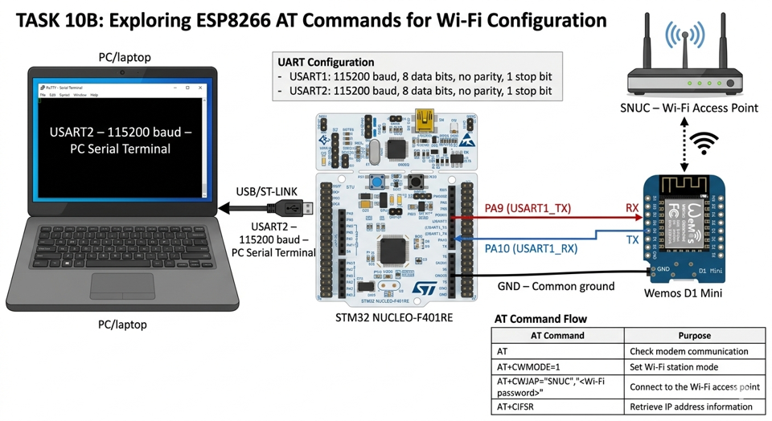

# CAT10 – Task 10B: Exploring ESP8266 AT Commands for Wi-Fi Configuration

## Experiment Details

| Parameter | Description |
|---|---|
| Experiment | CAT10 – Task 10B |
| Date | 09/10/2026 |
| Microcontroller | STM32 |
| Wi-Fi Module | Wemos D1 Mini (ESP8266) |
| Development Environment | STM32CubeMX / Keil µVision |
| Communication Interfaces | USART1 and USART2 |
| UART Baud Rate | 115200 |
| UART Configuration | 8 Data Bits, No Parity, 1 Stop Bit |

## Objective

To explore ESP8266 AT commands using UART communication with an STM32 microcontroller. The experiment involves checking modem communication, configuring Wi-Fi station mode, connecting to a wireless access point, and retrieving IP address information. Modem responses are forwarded to a PC terminal through USART2 for monitoring.

## Hardware Requirements

- STM32 development board
- Wemos D1 Mini (ESP8266)
- USB cable
- PC with a serial terminal application
- Jumper wires

## Circuit Diagram

## Hardware Connections

### USART1 – STM32 to ESP8266

| STM32 Pin | Wemos D1 Mini Pin | Purpose |
|---|---|---|
| PA9 (USART1_TX) | RX | Sends AT commands |
| PA10 (USART1_RX) | TX | Receives modem responses |
| GND | GND | Common ground |

### USART2 – STM32 to PC

USART2 is used to forward the ESP8266 modem responses to the PC terminal through the board's serial interface.

## USART Configuration

Both USART peripherals are configured with the following settings:

| Parameter | Configuration |
|---|---|
| USART1 | Communication with ESP8266 |
| USART2 | PC terminal communication |
| Baud Rate | 115200 |
| Data Bits | 8 |
| Parity | None |
| Stop Bits | 1 |

## Working Principle

The STM32 communicates with the ESP8266 Wi-Fi module using AT commands over USART1.

The ESP8266 processes the received commands and sends responses back through USART1. The STM32 receives these responses and forwards them to the PC terminal through USART2.

The experiment explores the following operations:

1. Verify communication with the ESP8266.
2. Configure the ESP8266 in Wi-Fi station mode.
3. Attempt connection to a specified wireless access point.
4. Retrieve the IP address information assigned to the module.

## AT Commands Used

| AT Command | Purpose |
|---|---|
| `AT` | Checks communication with the ESP8266 |
| `AT+CWMODE=1` | Configures the ESP8266 in station mode |
| `AT+CWJAP="SNUC","<Wi-Fi password>"` | Attempts to connect to the specified Wi-Fi access point |
| `AT+CIFSR` | Retrieves IP address information |

## Program Flow

1. Initialize the HAL library using `HAL_Init()`.
2. Configure the system clock using `SystemClock_Config()`.
3. Initialize GPIO, USART1, and USART2.
4. Declare the AT command strings and receive buffer.
5. Send the `AT` command to the ESP8266 through USART1.
6. Receive the modem response through USART1.
7. Forward the response to the PC terminal through USART2.
8. Send `AT+CWMODE=1` to configure station mode.
9. Receive and display the modem response.
10. Send the `AT+CWJAP` command with the Wi-Fi SSID and password.
11. Receive and display the connection response.
12. Send `AT+CIFSR` to retrieve IP address information.
13. Receive and forward the response to the PC terminal.

## Code Implementation

The program is developed in Embedded C using STM32 HAL libraries.

### Important HAL Functions and Utilities

| Function | Purpose |
|---|---|
| `HAL_Init()` | Initializes the STM32 HAL library |
| `SystemClock_Config()` | Configures the system clock |
| `MX_USART1_UART_Init()` | Initializes USART1 for ESP8266 communication |
| `MX_USART2_UART_Init()` | Initializes USART2 for PC terminal communication |
| `HAL_UART_Transmit()` | Sends AT commands and forwards modem responses |
| `HAL_UART_Receive()` | Receives responses from the ESP8266 |
| `memset()` | Clears the receive buffer before use |
| `strlen()` | Determines the length of command and response strings |
| `HAL_Delay()` | Introduces delays between successive AT commands |

## Source Files

| File | Description |
|---|---|
| `main.c` | Contains UART initialization, AT command transmission, response reception, and forwarding logic |
| `main.h` | Header file containing declarations |
| `startup` files | Startup and initialization support |
| `circuit.png` | Circuit connection diagram |

## Observations

- The STM32 communicates with the ESP8266 through USART1.
- The `AT` command is used to check modem communication.
- The `AT+CWMODE=1` command configures the module in station mode.
- The `AT+CWJAP` command attempts to connect the ESP8266 to the specified Wi-Fi network.
- The `AT+CIFSR` command requests IP address information.
- Modem responses are received by the STM32 and forwarded to the PC terminal through USART2.
- The PC terminal allows the communication and configuration responses to be monitored.

## Inference

The experiment demonstrates how an ESP8266 Wi-Fi module can be controlled using AT commands through UART communication with an STM32 microcontroller. The module is configured in station mode, instructed to connect to a wireless access point, and queried for IP address information.

Forwarding modem responses through USART2 provides a way to monitor the communication process and observe the results of each AT command.

## Conclusion

The experiment provides practical experience with UART-based communication between an STM32 microcontroller and an ESP8266 Wi-Fi module. By using AT commands, the STM32 can configure the module's Wi-Fi operating mode, attempt network connection, and retrieve IP address information.

It also demonstrates the use of two UART peripherals for modem communication and PC-based serial monitoring using STM32 HAL functions.