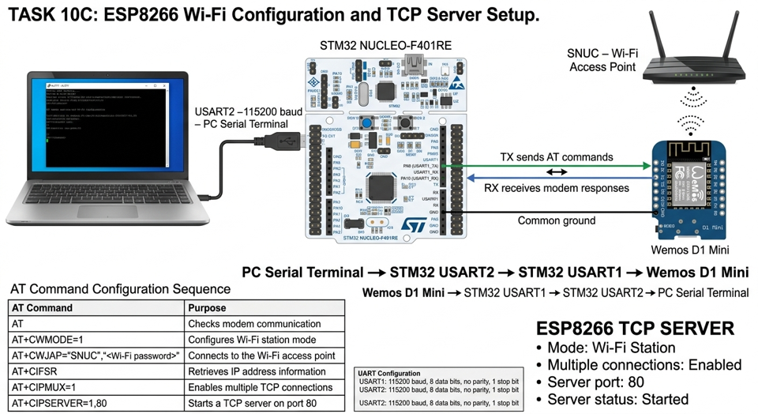

# CAT10 – Task 10C: ESP8266 Wi-Fi Configuration and TCP Server Setup

## Experiment Details

| Parameter | Description |
|---|---|
| Experiment | CAT10 – Task 10C |
| Date | 09/10/2026 |
| Microcontroller | STM32 |
| Wi-Fi Module | Wemos D1 Mini (ESP8266) |
| Development Environment | STM32CubeMX / Keil µVision |
| Communication Interfaces | USART1 and USART2 |
| UART Baud Rate | 115200 |
| UART Configuration | 8 Data Bits, No Parity, 1 Stop Bit |
| TCP Server Port | 80 |

## Objective

To configure an ESP8266 Wi-Fi module using AT commands transmitted from an STM32 microcontroller. The experiment involves establishing UART communication, connecting the ESP8266 to a Wi-Fi access point, retrieving its IP address, enabling multiple TCP connections, and setting up a TCP server on port 80.

## Hardware Requirements

- STM32 development board
- Wemos D1 Mini (ESP8266)
- USB cable
- PC with a serial terminal application
- Jumper wires

## Circuit Diagram

## Hardware Connections

### USART1 – STM32 to ESP8266

| STM32 Pin | Wemos D1 Mini Pin | Purpose |
|---|---|---|
| PA9 (USART1_TX) | RX | Sends AT commands |
| PA10 (USART1_RX) | TX | Receives modem responses |
| GND | GND | Common ground |

### USART2 – STM32 to PC

USART2 provides the serial communication interface between the STM32 and the PC terminal. It is used to forward modem responses for monitoring.

## USART Configuration

Both USART peripherals are configured with the following settings:

| Parameter | Configuration |
|---|---|
| USART1 | Communication with ESP8266 |
| USART2 | PC terminal communication |
| Baud Rate | 115200 |
| Data Bits | 8 |
| Parity | None |
| Stop Bits | 1 |

## Working Principle

The STM32 communicates with the ESP8266 Wi-Fi modem using AT commands transmitted through USART1.

The ESP8266 processes the commands and sends responses back to the STM32. These responses are received through USART1 and forwarded to the PC terminal through USART2.

After verifying basic communication, the ESP8266 is configured in station mode and instructed to connect to a Wi-Fi access point. Once the connection process is initiated, the STM32 retrieves the module's IP address, enables multiple TCP connections, and starts a TCP server on port 80.

## AT Commands Used

| AT Command | Purpose |
|---|---|
| `AT` | Checks communication with the ESP8266 |
| `AT+CWMODE=1` | Configures Wi-Fi station mode |
| `AT+CWJAP="SNUC","<Wi-Fi password>"` | Attempts to connect to the Wi-Fi access point |
| `AT+CIFSR` | Retrieves IP address information |
| `AT+CIPMUX=1` | Enables multiple TCP connections |
| `AT+CIPSERVER=1,80` | Starts a TCP server on port 80 |

## Program Flow

1. Initialize the HAL library using `HAL_Init()`.
2. Configure the system clock using `SystemClock_Config()`.
3. Initialize GPIO, USART1, and USART2.
4. Declare AT command strings and a receive buffer.
5. Send the `AT` command through USART1 to verify modem communication.
6. Configure the ESP8266 in station mode using `AT+CWMODE=1`.
7. Send the Wi-Fi credentials using the `AT+CWJAP` command.
8. Receive and display the modem's connection response.
9. Retrieve IP address information using `AT+CIFSR`.
10. Enable multiple TCP connections using `AT+CIPMUX=1`.
11. Start the TCP server on port 80 using `AT+CIPSERVER=1,80`.
12. Forward modem responses to the PC terminal through USART2.

## Code Implementation

The program is developed in Embedded C using STM32 HAL libraries.

### Important HAL Functions and Utilities

| Function | Purpose |
|---|---|
| `HAL_Init()` | Initializes the STM32 HAL library |
| `SystemClock_Config()` | Configures the system clock |
| `MX_USART1_UART_Init()` | Initializes USART1 for STM32–ESP8266 communication |
| `MX_USART2_UART_Init()` | Initializes USART2 for PC terminal communication |
| `HAL_UART_Transmit()` | Sends AT commands and forwards modem responses |
| `HAL_UART_Receive()` | Receives responses from the ESP8266 |

## Source Files

| File | Description |
|---|---|
| `main.c` | Contains UART initialization, AT command transmission, and modem response handling |
| `main.h` | Header file containing declarations |
| `startup` files | Startup and initialization support |
| `circuit.png` | Circuit connection diagram |

## Observations

- The STM32 communicates with the ESP8266 through USART1.
- The `AT` command is used to verify modem communication.
- The `AT+CWMODE=1` command configures the ESP8266 in station mode.
- The `AT+CWJAP` command attempts to connect the module to the specified Wi-Fi network.
- The `AT+CIFSR` command retrieves IP address information.
- The `AT+CIPMUX=1` command enables multiple TCP connections.
- The `AT+CIPSERVER=1,80` command starts a TCP server on port 80.
- Modem responses are forwarded to the PC terminal through USART2 for monitoring.

## Inference

The experiment demonstrates how an STM32 microcontroller can configure an ESP8266 Wi-Fi module using AT commands. After establishing communication and configuring the Wi-Fi connection, the module can be set up to accept TCP connections through a server running on port 80.

The experiment also demonstrates the use of separate UART peripherals for modem communication and PC-based serial monitoring.

## Conclusion

The experiment provides practical experience with ESP8266 Wi-Fi configuration and TCP server setup using an STM32 microcontroller. By sending AT commands through USART1, the STM32 can configure the Wi-Fi mode, attempt access point connection, retrieve IP address information, enable multiple connections, and start a TCP server.

This experiment introduces the fundamentals of Wi-Fi configuration, UART-based modem control, and TCP server initialization using STM32 HAL libraries.