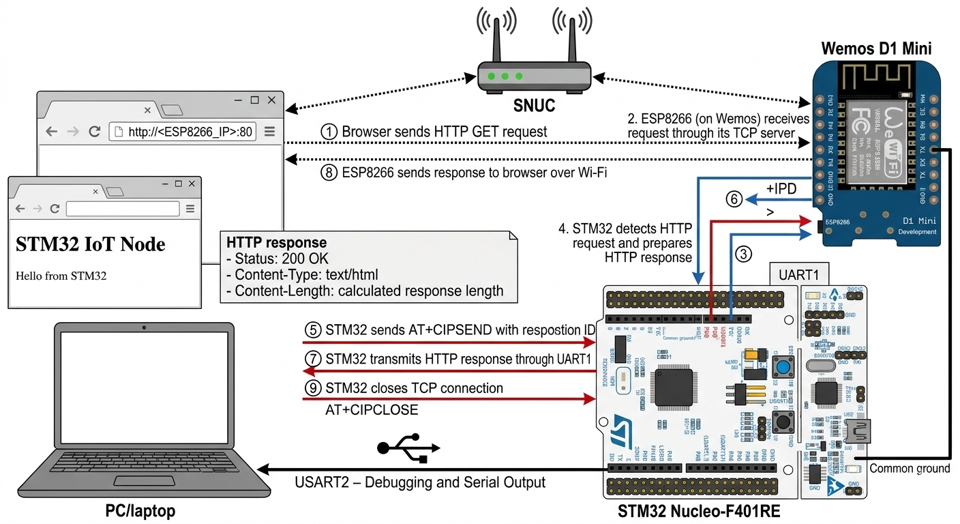

# CAT11 – Task 11B: HTTP Request Detection and Response Using ESP8266

## Experiment Details

| Parameter | Description |
|---|---|
| Experiment | CAT11 – Task 11B |
| Date | 15/10/2026 |
| Microcontroller | STM32 |
| Wi-Fi Module | Wemos D1 Mini (ESP8266) |
| Communication Interfaces | UART1 and UART2 |
| Network Protocol | HTTP over TCP |
| TCP Server Port | 80 |
| Development Environment | STM32CubeMX / Keil µVision |

## Objective

To implement basic HTTP request detection and response using an STM32 microcontroller and an ESP8266 Wi-Fi module. The experiment involves receiving HTTP requests from a browser, identifying the TCP connection information, constructing a static HTML response, and transmitting it to the client through the ESP8266.

## Hardware Requirements

- STM32 development board
- Wemos D1 Mini (ESP8266)
- PC or mobile device with a web browser
- PC with a serial terminal application
- USB cables
- Jumper wires

## Circuit Diagram



## Hardware Connections

### UART1 – STM32 to ESP8266

| Connection | Purpose |
|---|---|
| ESP8266 TX → STM32 UART1 RX | Receives data from the ESP8266 |
| ESP8266 RX → STM32 UART1 TX | Sends commands and responses to the ESP8266 |
| ESP8266 GND → STM32 GND | Common ground |

### UART2 – STM32 to PC

UART2 is used for debugging and displaying messages on the PC terminal.

### Network Connection

A PC or mobile device connected to the same Wi-Fi network accesses the ESP8266 TCP server through its assigned IP address and port 80.

## Working Principle

After configuring the ESP8266 as a TCP server in Task 11A, the STM32 continuously monitors UART1 for incoming data from the module.

When a browser sends an HTTP request, the ESP8266 forwards the received data to the STM32 through a `+IPD` notification. The STM32 detects this notification, extracts the TCP connection ID and received data length, and waits for the HTTP header terminator (`\r\n\r\n`).

Once the request is detected, the STM32 constructs a static HTTP response containing an HTML page. It then sends the response through the ESP8266 using the `AT+CIPSEND` command and closes the client connection using `AT+CIPCLOSE`.

## Program Flow

1. Initialize the request buffer and set the buffer index to zero.
2. Continuously receive data from the ESP8266 through UART1, one byte at a time.
3. Append the received bytes to the request buffer.
4. Search for the `+IPD` notification and HTTP header terminator (`\r\n\r\n`).
5. Extract the TCP connection ID and received data length.
6. Construct an HTTP response containing:
   - HTTP status: `200 OK`
   - Content type: `text/html`
   - Content length
   - HTML page content
7. Send the `AT+CIPSEND` command with the connection ID and response length.
8. Wait for the ESP8266 transmission prompt (`>`), using timeout control.
9. Transmit the HTTP response through UART1.
10. Close the TCP connection using `AT+CIPCLOSE`.
11. Clear the request buffer and continue listening for new requests.

## HTTP Response

The STM32 generates the following static HTML page:

```html
<html>
<body>
    <h1>STM32 IoT Node</h1>
    <p>Hello from STM32</p>
</body>
</html>
```

The HTML content is included in an HTTP response with a `200 OK` status and `text/html` content type.

## Code Implementation

The program is developed in Embedded C using STM32 HAL libraries.

### Important Functions and Commands

| Function / Command | Purpose |
|---|---|
| `HAL_UART_Receive()` | Receives incoming data from the ESP8266 |
| `strstr()` | Detects the `+IPD` notification and HTTP header terminator |
| `sscanf()` | Extracts the TCP connection ID and received data length |
| `snprintf()` | Constructs the HTTP response and AT command strings |
| `HAL_UART_Transmit()` | Sends commands and the HTTP response |
| `HAL_GetTick()` | Provides timeout control while waiting for the `>` prompt |
| `AT+CIPSEND` | Initiates transmission of the HTTP response |
| `AT+CIPCLOSE` | Closes the client TCP connection |

## Source Files

| File | Description |
|---|---|
| `main.c` | Contains UART reception, HTTP request detection, response construction, and transmission logic |
| `main.h` | Header file containing declarations |
| `startup` files | Startup and initialization support |
| `circuit.png` | Circuit connection diagram |

## Testing and Observations

- The ESP8266 acts as the network interface for the STM32 TCP server.
- A browser connected to the same Wi-Fi network can access the server using its assigned IP address and port 80.
- Incoming browser requests are forwarded to the STM32 through UART1 using `+IPD` notifications.
- The STM32 detects the HTTP header terminator and extracts the TCP connection information.
- An HTTP response containing a static HTML page is constructed.
- `AT+CIPSEND` is used to transmit the response through the ESP8266.
- `AT+CIPCLOSE` is used to close the client connection.
- UART2 provides a debugging interface for monitoring messages.

## Inference

The experiment demonstrates how an STM32 microcontroller can handle basic HTTP requests using an ESP8266 as its Wi-Fi network interface. By detecting incoming TCP data, identifying the client connection, constructing an HTTP response, and transmitting HTML content, the STM32 can serve a simple web page to a browser over Wi-Fi.

## Conclusion

The experiment successfully demonstrates the fundamentals of HTTP request detection and response generation using an STM32 microcontroller and ESP8266 module. It combines UART communication, TCP connection handling, HTTP header detection, string processing, and HTML response generation.

This provides practical experience in developing a basic embedded web server where an STM32 processes browser requests and serves static web content through a Wi-Fi module.