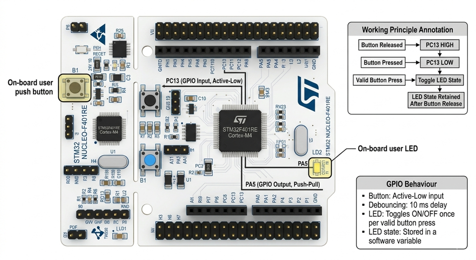

# CAT12 – Task 12B: On-board Switch Control with LED State Remembrance

## Experiment Details

| Parameter | Description |
|---|---|
| Experiment | CAT12 – Task 12B |
| Date | 16/10/2026 |
| Microcontroller | STM32F401RE (NUCLEO-F401RE) |
| Architecture | ARM Cortex-M4 |
| Development Environment | STM32CubeMX / Keil µVision |
| Programming Interface | ST-Link |
| GPIO Input | PC13 (On-board Push Button B1) |
| GPIO Output | PA5 (On-board LED LD2) |

## Objective

To control the on-board LED (LD2) on the NUCLEO-F401RE development board using its on-board push button (B1). The experiment demonstrates GPIO input handling, button debouncing, and LED state management, where each valid button press toggles the LED state.

## Hardware Requirements

- STM32 NUCLEO-F401RE development board
- USB cable for programming and power supply

No external components are required because both the push button and LED are available on the development board.

## Circuit Diagram

## Hardware Configuration

| Component | GPIO Pin | Configuration |
|---|---|---|
| On-board Push Button (B1) | PC13 | GPIO Input |
| On-board LED (LD2) | PA5 | GPIO Output |

### Connection Notes

- The on-board push button B1 is connected to PC13.
- The on-board user LED LD2 is connected to PA5.
- The button uses active-low logic, so PC13 reads LOW when pressed.
- No external resistors, LEDs, or push buttons are required.

## Working Principle

The push button is configured as a GPIO input, while PA5 is configured as a GPIO output.

The program continuously monitors the button state using `HAL_GPIO_ReadPin()`. When PC13 reads LOW, a short debounce delay of 10 ms is introduced to filter out unwanted transitions caused by mechanical button bouncing.

The program then verifies that the button is still pressed and waits until it is released. Once a valid press-and-release cycle is detected, the stored LED state is toggled and the corresponding output is written to PA5.

The LED therefore retains its selected state even after the push button is released.

## Program Flow

1. Initialize the HAL library using `HAL_Init()`.
2. Configure the system clock.
3. Initialize GPIO pins:
   - Configure PC13 as a GPIO input.
   - Configure PA5 as a GPIO output.
4. Initialize the LED state variable.
5. Continuously monitor the push button.
6. When PC13 reads LOW:
   - Apply a 10 ms debounce delay.
   - Verify that the button is still pressed.
   - Wait until the button is released.
   - Toggle the stored LED state.
7. Update the LED output on PA5 according to the stored state.
8. Continue monitoring for subsequent button presses.

## Code Implementation

The program is developed in Embedded C using STM32 HAL libraries.

### Important Functions and Variables

| Function / Variable | Purpose |
|---|---|
| `HAL_GPIO_ReadPin()` | Reads the push-button input on PC13 |
| `HAL_Delay(10)` | Provides a short 10 ms debounce delay |
| `HAL_GPIO_WritePin()` | Controls the LED connected to PA5 |
| `led` | Stores the LED state between button presses |
| `while()` | Continuously monitors the button and waits for its release |

## Source Files

| File | Description |
|---|---|
| `main.c` | Contains GPIO initialization, button monitoring, debouncing, and LED control logic |
| `main.h` | Header file containing declarations |
| `startup` files | Startup and initialization support |
| `circuit.png` | Circuit connection diagram |

## Testing and Observations

- The on-board push button B1 is read through PC13.
- PC13 reads LOW when the button is pressed.
- A 10 ms delay is used to debounce the button input.
- The program waits for the button to be released before toggling the LED.
- Each valid press-and-release cycle changes the LED state.
- The LED remains in its selected state after the button is released.
- The on-board LED LD2 is controlled through PA5.

## Key Concepts

- STM32 HAL programming
- GPIO input and output configuration
- Active-low push-button logic
- Mechanical switch debouncing
- Button press and release detection
- State variables and state retention
- LED control using `HAL_GPIO_WritePin()`

## Inference

The experiment demonstrates how an on-board push button can be used to control an LED through GPIO operations. Debouncing helps ensure that mechanical switch transitions do not cause unintended multiple toggles, while the stored LED state allows the output to remain unchanged after the button is released.

## Conclusion

The experiment successfully demonstrates on-board switch-based LED control using the NUCLEO-F401RE. Each valid button press toggles the LED between ON and OFF states, and the selected state is retained after release.

This provides practical experience with GPIO configuration, active-low input handling, software debouncing, and state management using STM32 HAL libraries.