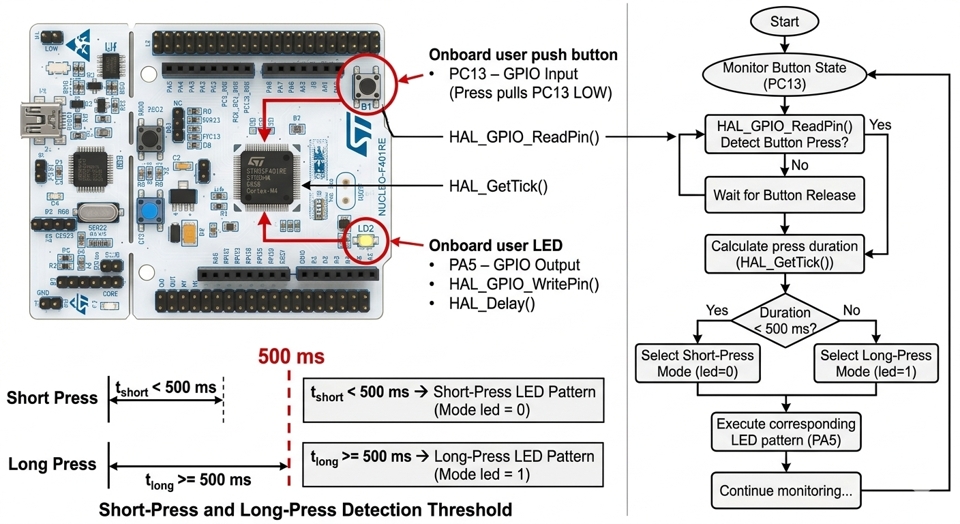

# CAT12 – Task 12C: Short-Press and Long-Press Detection

## Experiment Details

| Parameter | Description |
|---|---|
| Experiment | CAT12 – Task 12C |
| Date | 16/10/2026 |
| Microcontroller | STM32F401RE (NUCLEO-F401RE) |
| Architecture | ARM Cortex-M4 |
| Development Environment | STM32CubeMX / Keil µVision |
| Programming Interface | ST-Link |
| GPIO Input | PC13 (On-board Push Button B1) |
| GPIO Output | PA5 (On-board LED LD2) |
| Press Duration Threshold | 500 ms |

## Objective

To implement short-press and long-press detection using the on-board push button of the NUCLEO-F401RE. The experiment uses time-based event detection to distinguish between button presses and generates different LED patterns depending on the duration of the press.

## Hardware Requirements

- STM32 NUCLEO-F401RE development board
- USB cable for programming and power supply

No external components are required because the push button and LED are available on the development board.

## Circuit Diagram

## Hardware Configuration

| Component | GPIO Pin | Configuration |
|---|---|---|
| On-board Push Button (B1) | PC13 | GPIO Input |
| On-board LED (LD2) | PA5 | GPIO Output |

### Connection Notes

- The on-board push button B1 is connected to PC13.
- The on-board user LED LD2 is connected to PA5.
- No external push buttons, LEDs, or resistors are required.

## Working Principle

The program continuously monitors the push button connected to PC13. It uses `HAL_GetTick()` to measure the duration of each button press and classifies it using a threshold of 500 milliseconds.

Two operating modes are supported:

**Short Press:**
- A press duration of less than 500 ms selects short-press mode.
- The variable `led` is set to `0`.
- The corresponding short-press LED pattern is executed.

**Long Press:**
- A press duration of 500 ms or more selects long-press mode.
- The variable `led` is set to `1`.
- The corresponding long-press LED pattern is executed.

Different LED sequences are generated through GPIO output operations and timed delays. The program also checks for additional button presses while executing the patterns.

## Program Flow

1. Initialize the HAL library using `HAL_Init()`.
2. Configure the system clock.
3. Initialize GPIO:
   - Configure PC13 as a GPIO input.
   - Configure PA5 as a GPIO output.
4. Initialize the LED mode variable.
5. Continuously monitor the push button.
6. When a button press is detected:
   - Wait for the button to be released.
   - Measure the elapsed time using `HAL_GetTick()`.
   - Compare the measured duration against the 500 ms threshold.
7. Select the appropriate mode:
   - Less than 500 ms: Short-press mode.
   - 500 ms or more: Long-press mode.
8. Execute the corresponding LED pattern.
9. Continue monitoring for subsequent button presses.

## Code Implementation

The program is developed in Embedded C using STM32 HAL libraries.

### Important Functions and Variables

| Function / Variable | Purpose |
|---|---|
| `HAL_GPIO_ReadPin()` | Detects button presses and releases through PC13 |
| `HAL_GetTick()` | Provides millisecond timing for measuring press duration |
| `HAL_GPIO_WritePin()` | Controls the on-board LED through PA5 |
| `HAL_Delay()` | Generates timed intervals in the LED patterns |
| `led` | Stores the selected short-press or long-press mode |
| `prev` | Stores a tick-count reference for elapsed-time comparisons |
| `while()` | Continuously monitors the button and executes the selected LED sequence |

## Source Files

| File | Description |
|---|---|
| `main.c` | Contains button monitoring, press-duration measurement, and LED pattern logic |
| `main.h` | Header file containing declarations |
| `startup` files | Startup and initialization support |
| `circuit.png` | Circuit connection diagram |

## Testing and Observations

- The on-board push button B1 is monitored through PC13.
- Press duration is measured using `HAL_GetTick()`.
- A press lasting less than 500 ms selects short-press mode.
- A press lasting 500 ms or more selects long-press mode.
- Each mode executes its corresponding LED sequence through PA5.
- The program continues monitoring for additional button presses.

## Key Concepts

- STM32 HAL programming
- GPIO input and output configuration
- Button press and release detection
- Short-press and long-press classification
- Millisecond timing using `HAL_GetTick()`
- Time-based event detection
- LED pattern generation
- State management using variables

## Inference

The experiment demonstrates how the STM32F401RE can distinguish between short and long button presses using elapsed-time measurement. A 500 ms threshold determines which LED pattern is selected, illustrating time-based event detection and GPIO control.

## Conclusion

The experiment successfully demonstrates short-press and long-press detection using the NUCLEO-F401RE development board. By measuring button press duration with `HAL_GetTick()`, the microcontroller selects and executes different LED patterns based on the detected input.

This provides practical experience with GPIO handling, time-based event detection, button interaction, and LED control using STM32 HAL functions.